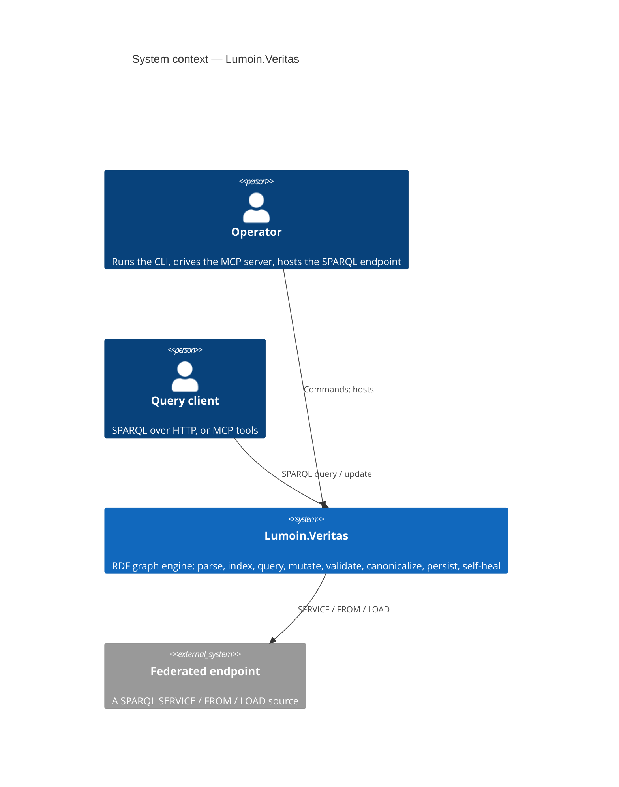
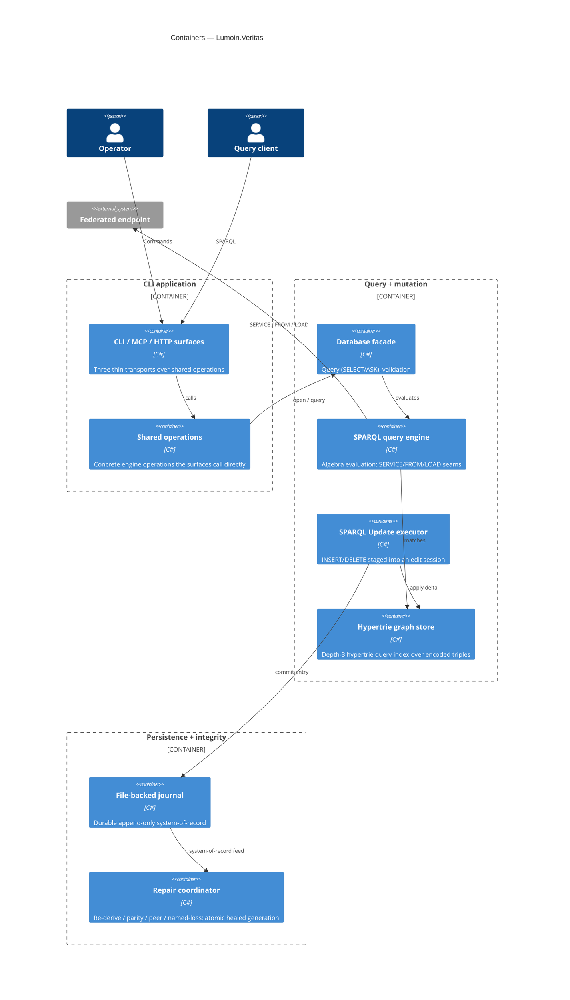
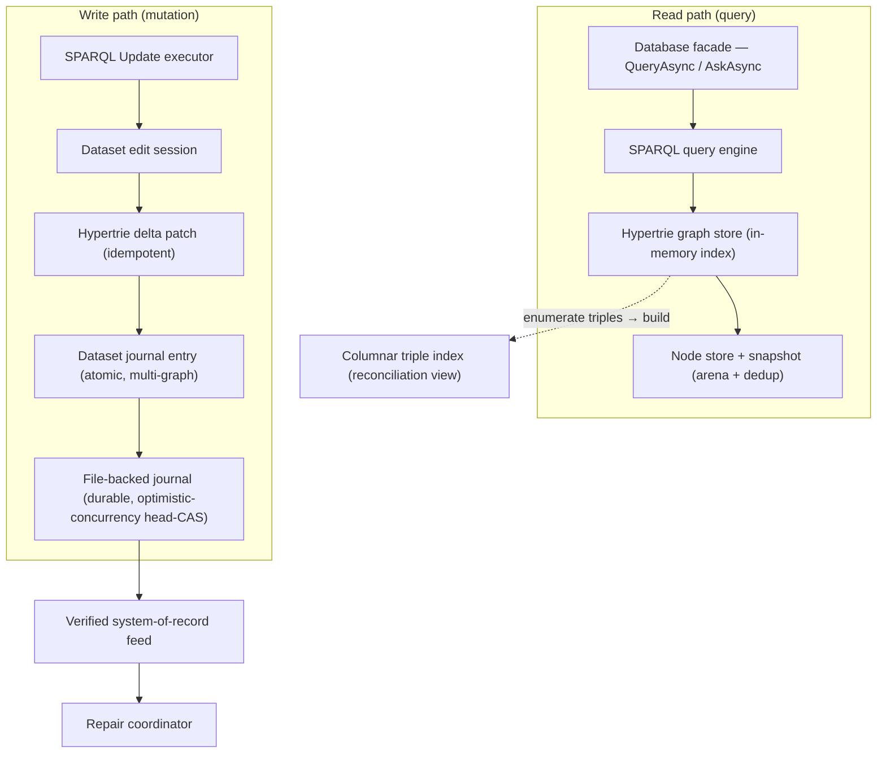
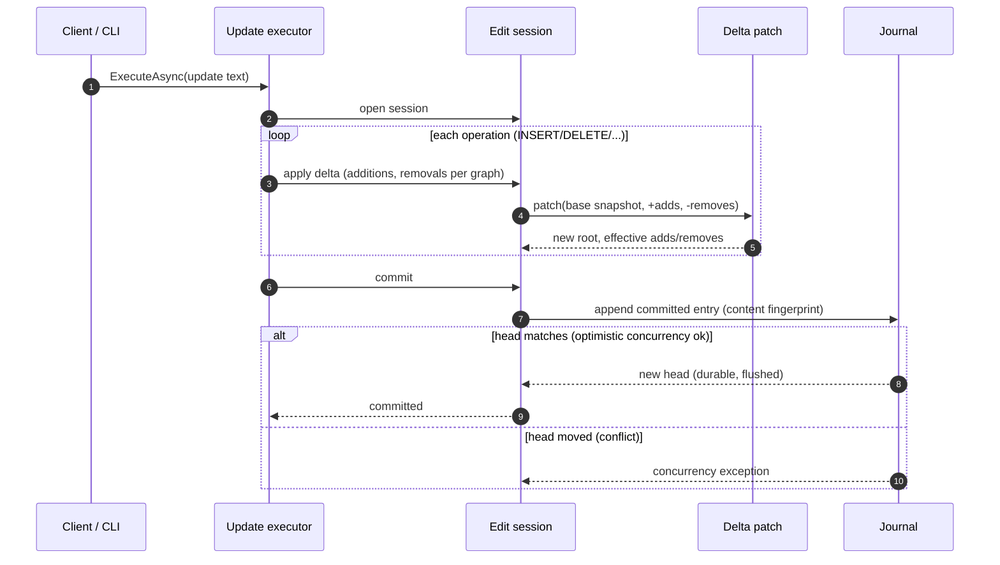
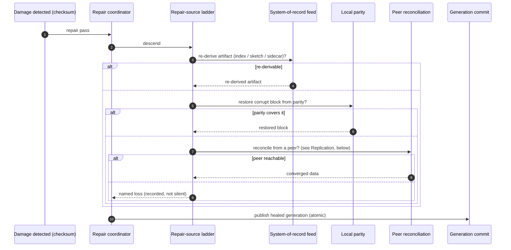
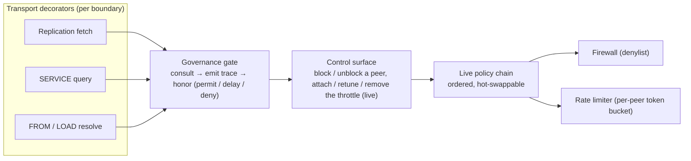
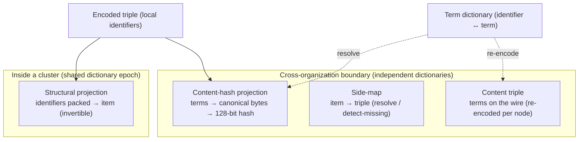

# Architecture

How Veritas is built: the substrate the libraries share, how data is queried, mutated, persisted, and self-healed,
and the design principles that hold across them. For *what* Veritas does and which packages provide it, see the
[README](README.md).

## Design principles

- **Encoded-triple substrate.** Terms are interned once (`Utf8StringPool`) and assigned compact identifiers
  (`TermDictionary`); triples are stored and indexed as encoded values, never as chains of strings. A term denotes
  the same thing across query, validation, reasoning, and serialization without being copied across boundaries.
- **Seam-wired IO.** Storage, hashing, randomness, identity, and network transport are delegate seams. The library
  owns no disk format, hash function, string interner, or socket; a host wires them in. This keeps the core
  transport-free and a peer of credential, identity, and cryptography stacks rather than a dependency of one.
- **Derived artifacts are re-derivable.** One verified feed is the system-of-record; the query index, the
  reconciliation sketches, and the parity sidecars are *derived* from it, so a corrupt derived artifact is
  rebuilt rather than lost.
- **Value-based control flow.** Expected, recoverable conditions are returned as values; exceptions are reserved
  for genuine invariant breaches.

## System context



## Containers



## Store layers — read and write



The columnar triple index is a *derived* view built from the store's triples; it is what the reconciliation tier
(below) compares, kept separate from the hypertrie query index that serves SPARQL.

## Sequence — mutation (SPARQL Update)



## Sequence — integrity repair

When a checksum detects damage, the repair coordinator descends a ladder of sources, cheapest first, and the
healed result is published atomically as a new generation, so a reader never sees a half-repaired store. A loss
that no source can recover is named explicitly rather than silently dropped.



---

# Replication and governance (in development)

The components in this section live in `Lumoin.Veritas.Replication` and `Lumoin.Veritas.Core.Network` (in
development — on the replication branch, not yet on the released line) and are individually tested. The two halves
differ in how far they are wired:

- **Anti-entropy replication is wired into the database facade.** A mutable `VeritasEngine` (`OpenMutableAsync`)
  seeds a reconciliation feed on commit, reconciles from a peer (`ReconcileFromPeerAsync`, refused on a
  dictionary-epoch mismatch), and serves its own sketch (`CreateSketchFetch`); a converged reconcile is written
  back through the journal as an ordinary mutation. These are public methods on the facade today.
- **Network governance is implemented and tested but not yet wired into the engine or CLI default.** The gate,
  firewall, rate limiter, live policy chain, and governed transport decorators exist, but no composition root
  constructs them in the shipped engine, so by default every call is permitted.
- **The CLI surfaces neither.** It stays a thin query/serve surface; reconcile and governance commands are not
  exposed there yet.

## Network governance

Every outbound network call (a replication fetch, a SPARQL `SERVICE` query, a `FROM`/`LOAD` graph resolve) and
inbound serve can be routed through one governance decision point: a closure-free decorator over the transport
seam consults a policy, emits a trace event, and honors the verdict — permit, delay (back off, then proceed), or
deny. The decision is asynchronous by contract so a policy may consult remote hardware (an HSM, a TPM, an OAuth or
EUDI backend); the decline is value-based, so a denied replication fetch reads as an unavailable peer and a denied
federation call behaves like an unreachable endpoint.



The policy chain is consulted in order and the first non-permit verdict wins, so the cheap decisive policy (the
firewall) runs first and a denied peer never reaches the rate limiter. The chain is hot-swappable behind one bound
decision point, so an editor, MCP, or CLI command can reconfigure a running node — block a peer, retune the
throttle — without a restart, while telemetry flows out on the diagnostics bus.

## Anti-entropy replication

Two replicas converge by exchanging rateless reconciliation sketches: each side persists a sketch of its
reconciliation items, fetches the peer's, decodes their exact symmetric difference under a symbol budget, and — only
on a complete peel — applies the difference as repair-as-ingest, growing the local replica to the union of both.
Every round ends at a value-based outcome (converged, already consistent, or a decline that applies nothing and
leaves the replica unchanged), so a session never half-applies, and a bounded loop retries declining rounds until
it converges.

A reconciliation item is produced by an injectable projection, which selects the **item domain**:

- The **structural** domain packs a triple's local term identifiers into the item — compact and invertible (the
  item *is* the triple), used between replicas that share a dictionary epoch (inside a cluster).
- The **content-hash** domain hashes the triple's term *content* into the item — stable across replicas that
  numbered their terms independently, used at a cross-organization boundary. It is not invertible, so a recovered
  peer-only item is fetched as terms and re-encoded into the local dictionary.



The two domains are related by the term dictionary, and a store moves between them by re-deriving its sketch
(cheap and reversible). Federation already exchanges terms — not identifiers — on the wire; the content-hash domain
makes the replication wire do the same. A content identifier crossing a trust boundary can be expressed as a
multiformats CID (`Lumoin.Veritas.Cid`) with a cryptographic hash; the compact in-process reconciliation key stays a
raw fixed-width digest.

### Sequence — content-hash reconcile

```mermaid
sequenceDiagram
  autonumber
  participant L as Local replica (dictionary A)
  participant CH as Content-hash session
  participant SM as Local side-map
  participant P as Peer replica (dictionary B)
  L->>CH: reconcile(local, dictionary A, hash, sketch fetch, triple fetch)
  CH->>CH: project local triples → content-hash sketch; build side-map
  CH->>P: fetch peer sketch (budget)
  P-->>CH: peer content-hash sketch
  CH->>CH: recover symmetric-difference items
  CH->>SM: partition each — held locally vs lacked (peer-only)
  alt no peer-only items
    CH-->>L: converged (local already a superset)
  else peer-only items present
    CH->>P: fetch triples for the peer-only items
    P-->>CH: triples as terms (resolved via the peer's side-map and dictionary)
    CH->>CH: verify each re-hashes to a requested item; re-encode verified triples into dictionary A
    alt every peer-only item satisfied
      CH-->>L: converged (apply → union, local encoding)
    else short or mismatched fetch
      CH-->>L: peer triples incomplete (unchanged; retry next round)
    end
  end
```

Because a content-hash item is not invertible, a fetched triple is verified — its terms must re-hash to the item it
was requested for — before it is applied, and the round converges only when every peer-only item is satisfied;
otherwise it declines without applying, appropriate to an untrusted cross-organization boundary. Blank-node and
RDF 1.2 triple-term identity across independent dictionaries follows RDF Dataset Canonicalization and is a planned
extension of this domain.
